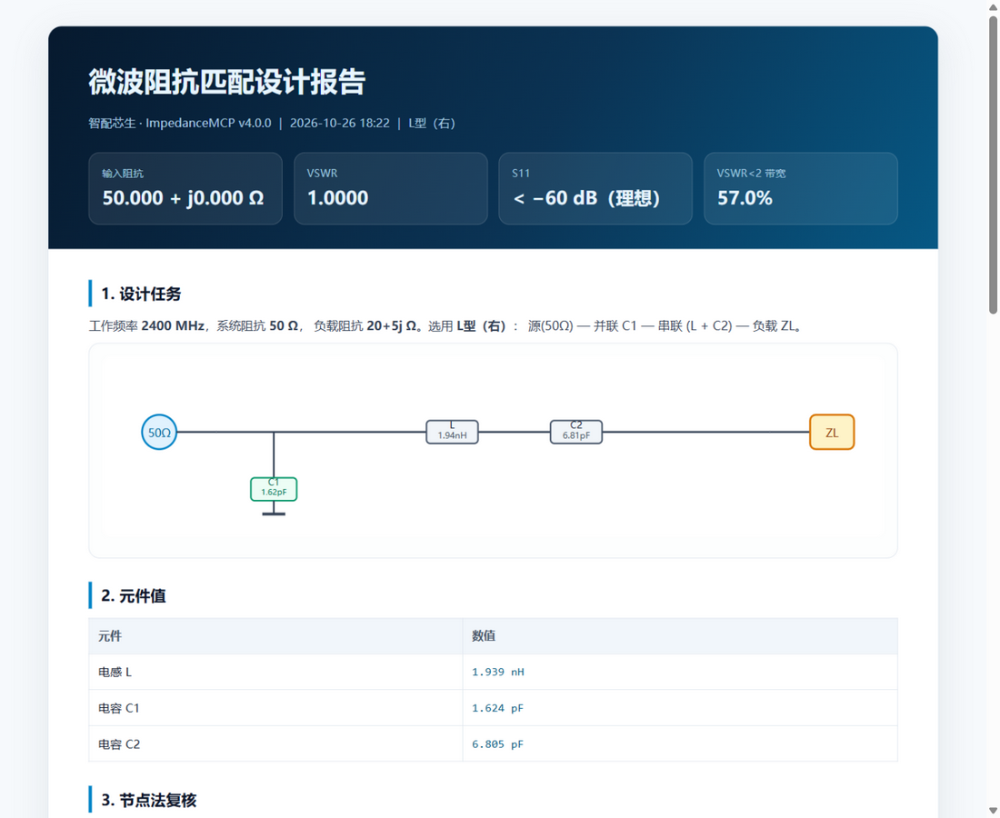

# 智配芯生 · ImpedanceMCP

**微波阻抗匹配智能计算与仿真软件 · v4.3.0**

**一个可独立运行的桌面软件 + 一个标准 MCP 服务器 + 一个支持 214 家国内外模型服务商的 AI 智能体。**

它把「Smith 圆图 + L/T/π 匹配网络 + 节点法复核 + 大模型工具调用 + MCP 标准接口」放进同一个桌面外壳：
既能像传统射频软件一样独立完成设计，也能让 ZCode / Claude Code / Codex / Cursor / Cherry Studio 等 MCP 客户端直接调用你的仿真能力。

> 上海交通大学集成电路学院（信息与电子工程学院）
> “智绘芯生，AI 赋能” AI 教与学活动周 · 赛道一（AI 智能体）
> 开发者：**卢瑞林、卢柯吉、林芷伊、张昀蕾** ｜ 更新日期：**2026-10-26**

---

## 0. 下载：一个压缩包

Release 只保留两个资产，不再分散：

- [`ImpedanceMCP_v4.3.0_Full_Bundle.zip`](https://github.com/RuilinLu/Impedance_Matching_Calculation/releases/tag/v4.3.0)（约 199 MB）：安装程序、原生窗口便携版、便携 MCP、源码、全部 PDF、原版 MATLAB 经典程序、VC++、WebView2 安装器、内部校验清单；
- `SHA256SUMS.txt`：压缩包本身的校验值。

**MATLAB Runtime 单独下载**：官方 Windows ZIP 约 4.64 GB，超过 GitHub 单文件 2 GiB 上限，无法放入 Release；`MyAppInstaller_mcr.exe`（约 974 MB）也未放入。新版软件/MCP 不需要 Runtime，只有原版 Classic 需要：

<https://ww2.mathworks.cn/products/compiler/matlab-runtime.html>

选择 **R2023b / Update 10 / Windows 64-bit**。


---

## 1. 三合一：软件 + MCP + 智能体

| 形态 | 入口 | 用途 |
|---|---|---|
| **独立软件** | 安装后双击桌面 `ImpedanceMCP`；或便携版 `ImpedanceMCP_v4.3.0_Portable.exe` | 不连任何 AI、不需要 MCP，直接做匹配设计、圆图、扫描、耐压、报告 |
| **MCP 服务器** | `ImpedanceMCP_MCP.exe --mcp` | stdio 接入 Claude Code / Codex / ZCode / Cursor / Claude Desktop |
| **MCP 服务器（HTTP/SSE）** | `ImpedanceMCP_MCP.exe --mcp --http 8790` | Streamable HTTP + legacy SSE，接入 Cherry Studio / 远程 MCP 客户端 |
| **AI 智能体** | 独立软件内的「AI 智能体」页 | 在 214 家服务商中选择模型，用自己的 Key 对话、调用 15 个工具 |

> 也就是说：**它自己能运行、自己会算；同时又能被别的 AI 软件当作工具调用。**
> 不是“只能挂在 MCP 上”的半成品。

---

## 2. 核心亮点

- **15 个 MCP 工具**：设计、正向扫描、网络复核、阻抗/导纳换算、耐压、带宽、拓扑对比、知识库、校验、报告、启动原版 exe、状态查询、预设。
- **三种 MCP 传输**：stdio、Streamable HTTP、legacy HTTP+SSE；支持 MCP 2024-11-05 / 2025-03-26 / 2025-06-18。
- **214 家模型服务商目录**：来自开源项目 [models.dev](https://github.com/sst/models.dev)，国内国外都有；**不设默认厂商、不设默认模型、不内置任何 Key**。
- **特殊协议适配**：OpenAI 兼容、Anthropic Messages 原生（Claude）、Azure OpenAI（`api-key` + 部署名）。
- **五种拓扑**：L 型（左/右）、T 型、π 型Ⅰ/Ⅱ；支持 `topology="auto"` 自动比较选优。
- **解析解 + 节点法双重校验**：每个设计都会用完整网络节点分析重新计算 `Zin / VSWR / S11`。
- **Smith 圆图动画**：串联沿等电阻圆、并联沿等电导圆，逐步演示负载 → 源端的匹配路径。
- **工程分析**：VSWR<2 带宽、±5% 元件容差灵敏度、峰值电压/电流应力、安全系数。
- **报告导出**：一键生成 HTML / Markdown 报告（含圆图、带宽、灵敏度、风险）。
- **离线可用**：除 AI 对话外，所有计算、绘图、MCP 工具均在本机运行。


---

## 3. 安装与启动

### 3.1 安装程序（推荐）

```text
双击 release/ImpedanceMCP_Setup_v4.3.0.exe
```

安装程序会：

- 检测 Windows x64、磁盘空间、VC++ 运行库、Microsoft Edge WebView2 Runtime；
- 缺少 WebView2 时自动静默安装（原生窗口需要；不会打开系统浏览器）；
- 支持修改安装目录；
- 可选创建桌面/开始菜单快捷方式；
- 可选写入 ZCode MCP 配置（自动备份原配置）；
- 安装后桌面快捷方式指向 `ImpedanceMCP.exe`，双击即打开**原生窗口**。

安装后的目录：

```text
{安装目录}\ImpedanceMCP.exe       主程序（原生窗口；双击即用）
{安装目录}\ImpedanceMCP_MCP.exe   MCP 控制台程序（stdio / HTTP+SSE）
{安装目录}\_internal\             运行时（含 WebView2 桥接）
{安装目录}\docs\                  内置帮助（HTML/PDF）
{安装目录}\classic\               原版经典界面（可选）
{安装目录}\unins000.exe           一键卸载程序（清除全部数据）
```

用户数据：`%LOCALAPPDATA%\ImpedanceMCP\`（配置、API Key、上传、报告、WebView2 缓存）。

**一键彻底卸载**：

- 开始菜单「一键卸载 ImpedanceMCP（清除全部数据）」；
- 或运行 `{安装目录}\unins000.exe`；
- 或在安装时勾选“桌面一键卸载快捷方式”。

卸载会删除：程序文件、`%LOCALAPPDATA%\ImpedanceMCP`、`%APPDATA%\ImpedanceMCP`、所有用户的同名数据目录、API Key、上传/报告、WebView2 用户缓存、MCP 客户端中的 `impedance-matching` 条目、开始菜单/桌面快捷方式、应用注册表项和 Inno 卸载注册项。**不会保留任何用户数据。**
共享的 Microsoft Edge WebView2 Runtime 属于系统组件，不随本软件删除，以免影响其他应用。

**便携版**（原生窗口，不安装）：

```text
双击 release/ImpedanceMCP_v4.3.0_Portable.exe
release/ImpedanceMCP_v4.3.0_Portable_MCP.exe   # 便携版 MCP 控制台
```

**源码运行**（需要 Python 3.10+）：

```bat
pip install numpy pypdf openpyxl Pillow pywebview pythonnet
start_app.bat
```

或：

```bat
python app\run_app.py
python app\run_app.py --browser   # 仅调试：退回本地浏览器界面
```

### 3.2 原版 MATLAB 软件

原版 `Impedance_Matching.exe` 由 MATLAB R2023b 编译，运行需要：

1. **`VC_redist.x64.exe`**（Visual C++ 运行库）
2. **MATLAB Runtime R2023b Update 10**

两种安装方式：

- **方式 A（推荐）**：直接安装
  `APP_Release_Release_Version/Main_Installation/MyAppInstaller_mcr.exe`。
  **该安装包已内置 MATLAB Runtime**（工程配置 `package.mcr=true`），安装它即可，不需要再单独装 Runtime。
- **方式 B（便携 exe）**：只使用
  `.../for_redistribution_files_only/Impedance_Matching.exe` 时，
  需要先安装 `Problem_Solution/VC_redist.x64.exe` 和
  `Problem_Solution/MATLAB_Runtime_R2023b_Update_10_win64.zip` 中的 Runtime。

> 新版独立软件和 MCP 的 Python 内核**不依赖 MATLAB Runtime**；Runtime 只影响“打开原版 exe”和“MATLAB R2025b 复核”。

### 3.3 配置模型服务（无默认厂商）

打开右上角「设置」：

1. 在「服务商」下拉框选择厂商（214 家，常用厂商在顶部；也可选“自定义 OpenAI 兼容服务”）；
2. Base URL 会自动填入，也可以手动修改；
3. 在「模型 ID」选择该厂商的模型，或使用「自定义模型 ID」填写任意模型名；
4. 填写你在该厂商控制台申请的 API Key；
5. 点击「测试连接」。

**没有默认服务商、没有默认模型、没有内置 Key。** 软件不会替用户选择厂商。

目录覆盖（部分）：

- 国内：DeepSeek、阿里云百炼（通义千问）、智谱 GLM、月之暗面 Kimi、硅基流动、火山引擎方舟（豆包）、MiniMax、阶跃星辰、商汤 SenseNova、魔搭 ModelScope、腾讯 TokenHub 等；
- 国外：OpenAI、Anthropic Claude、Google Gemini、xAI Grok、Mistral、Groq、Cohere、Together AI、DeepInfra、Perplexity、OpenRouter、NVIDIA NIM、Fireworks 等；
- 自定义：任意 OpenAI 兼容服务。

DeepSeek 用户可以直接在“DeepSeek 深度求索”下选择，例如：

- `deepseek-flash`
- `deepseek-v4-flash`
- `deepseek-v4-pro`

模型列表来自 models.dev；如果服务商新增了模型，使用「自定义模型 ID」填写即可。

环境变量（可选，不设默认厂商）：

```bat
set LLM_BASE_URL=https://api.deepseek.com/v1
set LLM_API_KEY=sk-...
set LLM_MODEL=deepseek-chat
```

API Key 只保存在本机，exe 为 `%LOCALAPPDATA%\ImpedanceMCP\data\config.json`，源码为 `data/config.json`，不会进入仓库。

---

## 4. 独立运行 vs MCP：它到底能不能“自己打开”？

**能，而且不是命令行 + 浏览器。**

- 安装版：双击桌面/开始菜单 `ImpedanceMCP`，打开的是一个带标题栏、图标和任务栏入口的**原生 Windows 窗口**；
- 便携版：双击 `ImpedanceMCP_v4.3.0_Portable.exe`，同样是原生窗口；
- 主程序是 Windows GUI 子系统，不会弹出命令行窗口，也不会调用 Edge/Chrome 打开本地网址；
- 界面由内置 WebView2 在窗口内渲染，数据仍由本机 `127.0.0.1` 服务提供；
- 不需要 AI、不需要 MCP、不需要联网，直接做设计、圆图、扫描、耐压、报告；
- 页面里的「AI 智能体」是可选的；不配置模型也能用所有计算功能；
- 原版 `Impedance_Matching.exe` 仍然保留，可从右上角「打开原版」启动。

```text
原生桌面窗口  +  MCP 服务器  +  可选 AI 智能体
```

`ImpedanceMCP_MCP.exe` 是独立的控制台程序，只供 MCP 客户端调用；双击主程序不会出现它。
只有开发调试时才使用 `ImpedanceMCP.exe --browser` 退回浏览器界面。

---

## 5. MCP 客户端兼容性

### 5.1 先说结论

**MCP 是开放标准，但不是所有 AI 软件都实现了它。**

- 本软件遵循 MCP 标准，覆盖 **stdio / Streamable HTTP / legacy SSE** 三种传输；
- Claude Code、Claude Desktop、Codex、ZCode、Cursor、Cherry Studio 等支持 MCP 的客户端可以接入；
- 本身没有 MCP 入口的聊天软件（例如某些旧版 Chatbox、DeepSeek 官方 App 的某些版本）**无法加载任何 MCP 服务器**——这是客户端限制，不是服务器协议问题；
- 不能承诺“市面上所有 AI 软件都完美适配”，但可以把标准该做的部分做全，并保留独立运行能力。

详细矩阵、各客户端配置、故障排查见：
**[docs/MCP兼容性说明.md](docs/MCP兼容性说明.md)**

### 5.2 客户端矩阵（摘要）

| 客户端 | MCP | 推荐传输 | 配置 |
|---|---|---|---|
| Claude Code | 是 | stdio | `.mcp.json` 或 `claude mcp add` |
| Claude Desktop | 是 | stdio | `claude_desktop_config.json` |
| OpenAI Codex CLI | 是 | stdio | `~/.codex/config.toml` |
| ZCode | 是 | stdio | `~/.zcode/cli/config.json` |
| Cursor | 是 | stdio | `.cursor/mcp.json` |
| Cherry Studio | 是（较新版本） | stdio / SSE | UI 添加 |
| Chatbox | 取决于版本 | SSE / HTTP | 较新版本支持 |
| DeepSeek 官方 App / Harness | 取决于版本 | — | 无 MCP 入口则无法加载 |

### 5.3 ZCode 配置（本机已写入）

```json
{
  "mcp": {
    "servers": {
      "impedance-matching": {
        "type": "stdio",
        "command": "C:\\path\\to\\ImpedanceMCP_MCP.exe",
        "args": ["--mcp"],
        "timeoutMs": 120000
      }
    }
  }
}
```

源码方式：

```json
{
  "mcp": {
    "servers": {
      "impedance-matching": {
        "type": "stdio",
        "command": "C:\\Python314\\python.exe",
        "args": ["D:\\path\\to\\app\\run_mcp.py"],
        "env": {"PYTHONUNBUFFERED": "1", "PYTHONIOENCODING": "utf-8"},
        "timeoutMs": 120000
      }
    }
  }
}
```

重启 ZCode 后，工具会以 `mcp__impedance-matching__*` 的形式出现。

### 5.4 Codex CLI

`~/.codex/config.toml`：

```toml
[mcp_servers.impedance-matching]
command = "C:\\path\\to\\ImpedanceMCP_MCP.exe"
args = ["--mcp"]
startup_timeout_sec = 30
tool_timeout_sec = 120
```

### 5.5 Claude Code

```bat
claude mcp add impedance-matching -- "C:\path\to\ImpedanceMCP_MCP.exe" --mcp
```

### 5.6 Claude Desktop

`%APPDATA%\Claude\claude_desktop_config.json`：

```json
{
  "mcpServers": {
    "impedance-matching": {
      "command": "C:\\path\\to\\ImpedanceMCP_MCP.exe",
      "args": ["--mcp"]
    }
  }
}
```

### 5.7 Cherry Studio / Chatbox

先启动：

```bat
ImpedanceMCP_MCP.exe --mcp --http 8790
```

在客户端 MCP 设置中添加 SSE：

```text
http://127.0.0.1:8790/sse
```

若客户端只支持 stdio，则用 exe + `--mcp`。

### 5.8 HTTP 端点

```text
POST   http://127.0.0.1:8790/mcp          Streamable HTTP (Mcp-Session-Id)
GET    http://127.0.0.1:8790/sse          legacy SSE 握手
POST   http://127.0.0.1:8790/messages     legacy SSE 消息
GET    http://127.0.0.1:8790/health       状态
```

默认只监听 `127.0.0.1`，不对外网开放。

### 5.9 工具清单

| 工具 | 作用 |
|---|---|
| `design_matching_network` | 反向设计：拓扑/频率/负载 → L、C1、C2、C3、VSWR、带宽 |
| `scan_matching_range` | 正向扫描：固定 L/C3，遍历电容范围 → 可匹配的 R/X 区域 |
| `evaluate_network` | 节点法复核给定元件值的 Zin/VSWR/S11/功率 |
| `convert_impedance_admittance` | Z ↔ Y |
| `compute_voltage_stress` | 峰值电压、RMS 电流、安全系数 |
| `analyze_bandwidth` | VSWR 扫频与分数带宽 |
| `compare_topologies` | 五种拓扑可行性与带宽排序 |
| `get_topology_guide` | 拓扑原理、适用条件、公式 |
| `get_smith_trajectory` | 返回 Γ 平面轨迹采样点 |
| `search_knowledge` | 本地微波匹配知识库 |
| `validate_design` | 工程风险校验 |
| `export_design_report` | 生成 HTML/Markdown 报告 |
| `launch_classic_app` | 启动原版 `Impedance_Matching.exe` |
| `get_system_status` | 版本、LLM、MATLAB、exe 状态 |
| `list_presets` | 常用频段/负载预设 |

资源：`impedance://catalog`、`impedance://knowledge`、`impedance://status`。
提示模板：`design_match`、`explain_topology`、`troubleshoot`。

---

## 6. 使用界面

### 6.1 AI 智能体

- 在设置里选择服务商、模型并填写自己的 Key；
- 直接用自然语言描述负载与频率，智能体会调用工具并把结果渲染成元件卡片；
- 支持附件：`.txt/.md/.csv/.json/.pdf/.docx/.xlsx/.pptx/.ipynb/.py/.m` 等（单文件 ≤25 MB）；
- 右侧“当前设计上下文”同步最近一次设计的元件值、VSWR、带宽和圆图缩略图；
- 工具调用过程可见：名称、耗时、摘要、可展开的原始返回。

### 6.2 匹配设计

- 选择拓扑（或“自动”），输入频率、Z0、负载 R/X；
- 自动选值可自动选择可行的 L 与 C3；关闭后可手动指定；
- 点击「求解设计」得到解析解；右侧同时给出节点法复核的 `Zin`、`VSWR`、`S11`；
- Smith 圆图支持播放/暂停/重置/速度；步骤列表可点击跳到对应路径；
- 下方展示带宽曲线、±5% 灵敏度、元件表、工程提示、可选拓扑对比；
- 「MATLAB 复核」调用 MATLAB R2025b 批处理独立复算（约 15–20 秒）；
- 「扫描范围」跳到圆图分析页并自动运行正向扫描。


### 6.3 耐压分析

- 输入功率、额定电压，点击「从当前设计填入」可复用设计结果；
- 表格给出各元件峰值电压、RMS 电压、峰值电流、RMS 电流和安全系数；
- 柱状图按安全系数着色：绿色 ≥2，黄色 ≥1.3，红色 <1.3。


### 6.4 报告

点击右上角「导出报告」生成 HTML，并在原生子窗口打开；按 `Ctrl+P` 可另存为 PDF。
报告包含：设计任务、拓扑图、元件表、节点法复核、Smith 圆图、带宽曲线、步骤、灵敏度、风险提示、团队信息。



---

## 7. 计算模型

### 7.1 网络与节点法

每个拓扑都被展开成无损集总网络，用节点电压法求解：

```text
Y · V = I
```

源用 50Ω Thevenin 等效（`Vs = sqrt(8·P·50)`），负载为 `Z_L`。
由 `Zin = V_s / I_in` 得到输入阻抗，再计算：

```text
Γ = (Zin − Z0) / (Zin + Z0)
VSWR = (1 + |Γ|) / (1 − |Γ|)
S11(dB) = 20 log10 |Γ|
```

元件电压/电流由节点电压直接得到，因此耐压分析包含源阻抗的负载效应。

### 7.2 五种拓扑

| 拓扑 | 结构 | 适用 |
|---|---|---|
| L 型（右） | 源 — 并联 C1 — 串联 L+C2 — 负载 | `R_L < Z0` |
| L 型（左） | 源 — 串联 L+C2 — 并联 C1 — 负载 | `R_L > Z0` |
| T 型 | 源 — 串 C3 — 节点（并 L+C2）— 串 C1 — 负载 | 需要中间节点调节/带宽 |
| π 型Ⅰ | 源 — 并 C3 — 串 L+C2 — 并 C1 — 负载 | C-L-C 结构 |
| π 型Ⅱ | 源 — 并 C1 — 串 L+C2 — 并 C3 — 负载 | 低阻负载 |

公式与推导见 [`docs/技术白皮书.md`](docs/技术白皮书.md)。

### 7.3 自动选值

当用户不指定 L/C3 时，软件按可行性条件选取实用值：

- L 型：由 `denom = ωL + d0 > 0` 反推最小 L，再取 1.5× 裕量；
- T 型：令中间虚拟电阻 `R_v ≈ max(1.8R_L, 75Ω)`，反解 C3；
- π 型Ⅰ：令源端等效电阻 `R_S ≈ min(0.45R_par, 40Ω)`，反解 C3；
- π 型Ⅱ：令负载并联 C3 后的等效电阻 `R_eff ≈ min(0.45R_par, 25Ω)`，反解 C3。

如果负载落在固定电容拓扑的物理不可行区，会返回明确的 `ok=false`、物理原因和替代拓扑建议。

---

## 8. 正确性验证

### 8.1 测试用例

`app/tests/` 包含五类测试：

- `test_engine.py`：5 拓扑、频段、随机负载、扫描、带宽、耐压、报告；
- `test_mcp_protocol.py`：initialize、15 工具、resources、prompts、错误处理；
- `test_physics.py`：**独立 ABCD 级联矩阵** vs 节点法、正向扫描逐点反算、轨迹连续性、功率守恒、VSWR 关系；
- `test_web_help.py`：帮助文档 HTTP 头（中文文件名 UTF-8 编码）与安装说明白名单；
- `test_cleanup.py`：一键卸载的 MCP 条目识别、JSON/TOML 精确删除。

```text
Ran 29 tests ... OK
```

所有成功设计的 `VSWR < 1.001`，`|Zin − 50| < 0.01 Ω`。
详细推导与审计见 [`docs/计算正确性审计.md`](docs/计算正确性审计.md)。

### 8.2 MATLAB R2025b 交叉验证

同一组设计分别用 Python 与 MATLAB R2025b 计算：

```text
MATLAB 交叉验证：5/5 通过
l_right  pass  py 1.000000  ml 1.000000  dz 0.0
l_left   pass  py 1.000000  ml 1.000000  dz 0.0
t        pass  py 1.000000  ml 1.000000  dz 0.0
pi1      pass  py 1.000000  ml 1.000000  dz 0.0
pi2      pass  py 1.000000  ml 1.000000  dz 0.0
```

### 8.3 MCP 协议测试

`app/tests/test_mcp_protocol.py` 覆盖 initialize、tools/list、tools/call、resources、prompts、错误处理：

```text
Ran 11 tests ... OK
```

### 8.4 MCP HTTP / SSE 实测

- Streamable HTTP：`POST /mcp` + `Mcp-Session-Id`，15 个工具、设计调用通过；
- Legacy SSE：`GET /sse` + `POST /messages`，initialize / tools/list 通过；
- 独立 exe：`--mcp` 15 个工具、双击启动原生窗口与计算均通过。

### 8.5 安装程序与内置帮助

- 静默安装到自定义目录通过；
- 桌面/开始菜单快捷方式创建通过；
- 可选经典界面文件复制通过；
- `--configure-mcp zcode` 自动写入并备份配置通过；
- 安装后 `ImpedanceMCP.exe` 独立运行、MCP、214 服务商、`/help/用户手册.html`、设计计算通过；
- 一键卸载：运行中的程序被关闭，程序目录、`%LOCALAPPDATA%`/`%APPDATA%` 数据、API Key、上传/报告、WebView2 缓存、MCP 配置、快捷方式和注册表项全部清除；
- 帮助中心包含用户手册、MCP 兼容性、计算正确性审计、技术白皮书、架构、比赛说明、安装与杀毒说明。

安装与杀毒说明见 [`docs/安装与杀毒软件说明.md`](docs/安装与杀毒软件说明.md)。

---

## 9. 目录结构

```text
.
├─ app/
│  ├─ impedance_mcp/
│  │  ├─ engine.py          # 计算内核（五种拓扑 + 节点法）
│  │  ├─ tools.py           # 15 个 MCP 工具
│  │  ├─ mcp_server.py      # MCP stdio / Streamable HTTP / legacy SSE
│  │  ├─ agent.py           # 多模型工具调用智能体
│  │  ├─ llm.py             # OpenAI 兼容 + Anthropic + Azure 适配
│  │  ├─ providers.py       # 服务商目录加载
│  │  ├─ providers.json     # 214 家服务商与模型（来自 models.dev）
│  │  ├─ desktop.py         # 原生 WebView2 窗口（无浏览器、无控制台）
  │  ├─ cleanup.py         # 一键彻底卸载：数据/配置/MCP/注册表
  │  ├─ configure_mcp.py   # 一键写入 ZCode/Claude/Codex 配置
│  │  ├─ attachments.py     # PDF/DOCX/XLSX 附件解析
│  │  ├─ reports.py         # HTML/Markdown 报告
│  │  ├─ matlab_bridge.py   # MATLAB R2025b / 原版 exe
│  │  ├─ config.py          # 配置与路径（支持 PyInstaller 冻结）
│  │  ├─ knowledge.py       # 本地知识库
│  │  └─ web/               # 前端（index.html/styles.css/app.js/smith.js）
│  ├─ matlab/
│  │  ├─ mw_design.m        # MATLAB 解析解 + 节点法复核
│  │  ├─ mw_batch_entry.m   # -batch 批处理入口
│  │  └─ original_v3/       # V3 原版 App Designer 提取源码
│  ├─ tests/
│  │  ├─ test_engine.py
│  │  ├─ test_mcp_protocol.py
│  │  └─ test_physics.py    # ABCD/扫描/轨迹/功率独立审计
│  ├─ launcher.py           # 统一入口（默认原生窗口，--browser 调试）
│  ├─ run_app.py
│  └─ run_mcp.py
├─ docs/                    # 用户手册、MCP、审计、白皮书、架构、比赛、安装/杀毒
├─ installer/
│  ├─ ImpedanceMCP.iss      # Inno Setup 安装脚本
│  ├─ sign_example.ps1      # 代码签名模板（需自己的证书）
│  ├─ LICENSE.txt
│  └─ README.txt
├─ release/
│  ├─ build_exe.py          # PyInstaller portable + onedir
│  ├─ build_providers.py    # 从 models.dev 生成服务商目录
│  ├─ version_info.txt
│  ├─ icon.ico
│  └─ RELEASE_NOTES.md
├─ APP_Release_Release_Version/  # 原版安装包、Runtime、问题解决文件
├─ SECURITY.md
├─ start_app.bat
├─ start_mcp.bat
├─ README.md
├─ CHANGELOG.md
└─ LICENSE
```

---

## 10. 常见问题

**Q：新版外壳为什么还需要 MATLAB？**
A：不需要。默认 Python 内核完成全部计算；MATLAB 只用于“复核”和“打开原版 exe”。没有 MATLAB 也能使用所有 MCP 工具和 AI 对话。

**Q：`MyAppInstaller_mcr.exe` 是否包含 MATLAB Runtime？**
A：包含。工程配置 `package.mcr=true`，这是 MATLAB Compiler 的“打包 Runtime”安装包，直接安装即可。
`for_redistribution_files_only/Impedance_Matching.exe` 是便携版，需要单独安装 Runtime。

**Q：为什么设置里没有默认模型厂商？**
A：这是刻意设计。软件内置 214 家服务商，但**不替用户选择**；你需要自己选择服务商、模型并填写自己的 API Key。这样国内外模型都可用，也不绑定任何一家。

**Q：DeepSeek Flash 在哪？**
A：选择“DeepSeek 深度求索”，模型列表中有 `deepseek-flash`、`deepseek-v4-flash` 等；如果服务商新增了模型，用「自定义模型 ID」填写即可。

**Q：MCP 是不是所有 AI 软件都能用？**
A：不是。MCP 是标准，但客户端必须实现 MCP。支持 MCP 的客户端（Claude Code / Codex / ZCode / Cursor / Cherry Studio 等）可以接入；没有 MCP 入口的聊天软件无法加载任何 MCP 服务器。详见 `docs/MCP兼容性说明.md`。

**Q：这个软件能不能自己运行？**
A：能。双击 `ImpedanceMCP.exe` 即打开独立界面，不依赖 MCP、不依赖 AI 客户端。

**Q：DeepSeek 报 401 / 404？**
A：401 是 Key 无效；404 是 Base URL、模型 ID 或 Azure 部署名不对。检查服务商控制台与设置。

**Q：设计返回“无解”或 C2 为负？**
A：这是物理限制，不是程序错误。固定电容拓扑无法匹配强容性/强感性负载；换 `topology="auto"` 或改用建议的拓扑。

**Q：C2 只有 0.00x pF？**
A：说明手动指定的 L 太大。打开“自动选值”，或把 L 减小到 1–10 nH 量级。

**Q：ZCode 看不到工具？**
A：确认 `~/.zcode/cli/config.json` 的 `mcp.servers` 中有 `impedance-matching`，路径存在，然后**完全退出并重启 ZCode**。可先用 `ImpedanceMCP_MCP.exe --mcp` 或 `python app\run_mcp.py` 手动验证。

**Q：能不能用本地 Ollama / LM Studio？**
A：当前安全策略拒绝本机/内网地址，避免 SSRF 风险；请通过公网网关或反向代理。云服务商目录已覆盖 214 家。

---

## 11. 团队

| 成员 | 分工 |
|---|---|
| **卢瑞林** | 项目负责人 · 算法与 MCP 架构 |
| **卢柯吉** | MATLAB 计算内核与仿真验证 |
| **林芷伊** | 交互设计、可视化与文档 |
| **张昀蕾** | 测试、演示与用户研究 |

上海交通大学集成电路学院（信息与电子工程学院）
“智绘芯生，AI 赋能” AI 教与学活动周 · 2026-10-26

**联系**：radarlurui@gmail.com ｜ Lu_Skywalker2915@sjtu.edu.cn
**GitHub**：<https://github.com/RuilinLu/Impedance_Matching_Calculation>
**v4.3.0 Release**：<https://github.com/RuilinLu/Impedance_Matching_Calculation/releases/tag/v4.3.0>

---

## 12. 许可与致谢

- 代码：MIT License（见 `LICENSE`）
- 原版 MATLAB App Designer 软件、`Impedance_Matching.exe` 及相关图片：由本项目团队开发，版权归团队所有。
- 服务商/模型目录：来自开源项目 [models.dev](https://github.com/sst/models.dev)，仅包含公开的端点、模型 ID 与文档链接，不含任何密钥。
- 安全与杀毒误报说明：见 [`SECURITY.md`](SECURITY.md) 与 [`docs/安装与杀毒软件说明.md`](docs/安装与杀毒软件说明.md)。
- 感谢 MathWorks 提供的 MATLAB R2025b 与 App Designer / RF Toolbox 生态。

> 本软件用于教学、科研与工程估算；正式产品请用实际元件模型、网络分析仪与实测数据复核。
