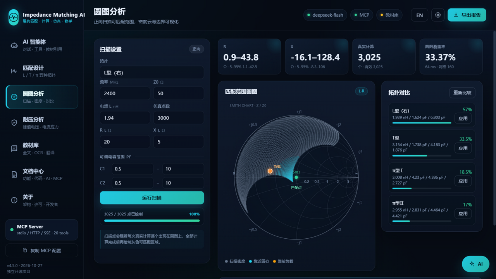
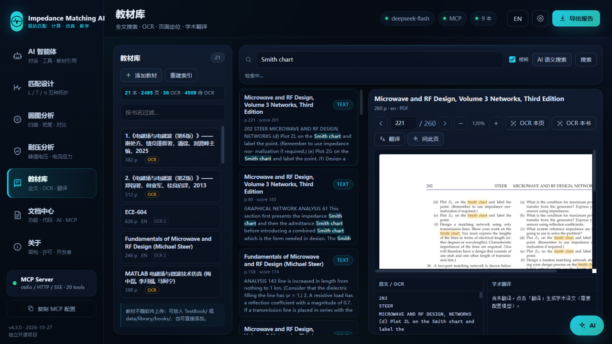
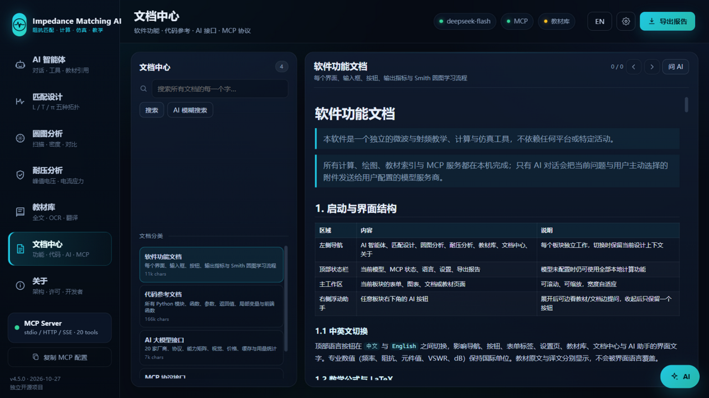

# Impedance Matching AI

**微波阻抗匹配智能计算、Smith 圆图仿真、教材检索与 MCP 服务**

一个可独立运行的 Windows 桌面软件，也是一个标准 MCP 服务器。它把匹配网络设计、节点法复核、Smith 圆图、教材全文/OCR/翻译、四类工程文档和工具调用大模型放进同一个本地应用。

> 独立开源项目 · MIT License · 不绑定任何平台或模型厂商
> 开发者：卢瑞林、卢柯吉、林芷伊、张昀蕾

---

## 界面预览










## 下载与安装

Release 提供完整安装程序、Windows 便携版、MCP 独立程序和源码包：

| 资产 | 用途 |
|---|---|
| `Impedance_Matching_AI_v4.3.0_Setup.exe` | 约 365 MB · 完整安装程序：主程序 + MCP + 离线说明书 + 教材数据库 + VC++/WebView2 检测 |
| `Impedance_Matching_AI_v4.3.0_Portable.exe` | 免安装便携版，双击即用 |
| `Impedance_Matching_AI_v4.3.0_MCP.exe` | 独立 MCP 服务（stdio / HTTP / SSE） |
| `Impedance_Matching_AI_v4.3.0_Source.zip` | 干净源码，不含教材、用户数据、API Key |
| `SHA256SUMS.txt` | 下载校验 |

**安装程序会：**

1. 检测并安装 Microsoft VC++ 运行库（如缺失）；
2. 检测并安装 Microsoft Edge WebView2 Runtime（如缺失）；
3. 安装主程序、MCP 程序、`docs/` 离线说明书、MathJax 与 `TextBook/` 教材入口；
4. 创建 `%LOCALAPPDATA%\ImpedanceMatchingAI\data\library\index.sqlite3` 教材数据库；
5. 创建开始菜单、可选桌面快捷方式与“一键卸载”。

**卸载程序会：** 关闭主程序与 MCP 进程，删除程序文件、快捷方式、MCP 客户端配置，以及 `%LOCALAPPDATA%\ImpedanceMatchingAI` 下的 API Key、上传、报告、教材索引与 WebView2 缓存；不会删除共享的 WebView2 Runtime。

## 核心功能

| 模块 | 能力 |
|---|---|
| 匹配设计 | L 型（左/右）、T 型、π 型Ⅰ/Ⅱ；解析解 + 完整网络节点法复核；自动选型 |
| Smith 圆图 | 逐段动画、负载/匹配点、等电阻/等电导圆、步骤回放 |
| 圆图分析 | 正向扫描可匹配范围；灰色密度云、外包络边界、悬停 Z/Γ/VSWR |
| 工程分析 | VSWR<2 带宽、±5% 容差灵敏度、峰值电压/电流与安全系数 |
| 教材库 | PDF/DOCX/PPTX/XLSX 索引、全文/模糊搜索、OCR、页面渲染缩放、学术翻译、引用截图 |
| 文档中心 | 软件功能、代码参考、AI 接口、MCP 协议；全文高亮与 AI 模糊搜索 |
| AI 智能体 | 任意文件、剪贴板、拖拽、图片/扫描页视觉输入；20 个本地工具；教材引用 |
| 模型设置 | 20 家厂商、逐模型能力/价格、峰谷计价、缓存与上下文统计、目录一键更新 |
| MCP | stdio / Streamable HTTP / legacy SSE；20 个工具、5 个资源、5 个提示模板 |
| 公式渲染 | 离线 MathJax，完整支持行内/独立 LaTeX、矩阵、分段函数、align、cases、物理/化学宏包 |

## 教材库与数据库

教材不随仓库或安装包发布，用户可自行添加：

- 安装目录或项目目录的 `TextBook/`；
- `%LOCALAPPDATA%\ImpedanceMatchingAI\TextBook\`；
- `%LOCALAPPDATA%\ImpedanceMatchingAI\data\library\books\`；
- 或在软件“教材库”点击“添加教材”。

本地 SQLite 数据库：

```
%LOCALAPPDATA%\ImpedanceMatchingAI\data\library\index.sqlite3
```

安装程序通过 `--init-data` 自动创建数据库、`books/`、`TextBook/` 与说明文件。首次打开教材库也会自动扫描并建立索引。

支持格式：PDF、TXT、Markdown、TeX、DOCX、PPTX、XLSX、IPYNB；旧版 `.doc/.ppt/.xls` 会尽量提取可读文本。扫描版 PDF 使用本地 RapidOCR，可单页或按页码范围识别。教材只在本机读取和索引，不会上传。

## 模型配置

设置 → 模型服务：

1. 选择服务商（内置 20 家，可一键更新）；
2. 选择协议（OpenAI 兼容 / Anthropic / 自定义 URL）；
3. 选择模型或填写自定义模型 ID；
4. 填写自己的 API Key（仅保存在本机 `data/config.json`）。

模型详情页可设置上下文、最大输出、视觉/音频、工具调用、JSON、思考模式、峰谷价格、币种、并发限制与谷时窗口。对话结束后显示本轮输入/输出 tokens、缓存命中率、上下文占用率、费用与峰谷时段。

目录更新支持 models.dev、当前厂商 `/models`、官方公告抓取与 AI 校对补丁；每次更新自动备份，可回滚。

### DeepSeek 示例

| 模型 | 上下文 | 输出 | 思考 | 视觉 | 工具 | 谷时价格（元/百万 tokens） | 峰时 |
|---|---|---|---|---|---|---|---|
| `deepseek-flash` | 1M | 384K | 支持 | 支持 | 支持 | 命中 0.02 / 未命中 1 / 输出 4 | 0.04 / 2 / 8 |
| `deepseek-v4-pro` | 1M | 384K | 支持 | 不支持 | 支持 | 命中 0.15 / 未命中 4.5 / 输出 13.5 | 0.30 / 9 / 27 |

## 文档中心

文档中心内置四个独立域，均可逐字全文搜索：

- **软件功能**：每个界面、输入、按钮、指标与 Smith 圆图学习流程；
- **代码参考**：AST 自动生成的模块、函数、参数、返回、局部变量与前端函数；
- **AI 接口**：厂商、协议、能力矩阵、视觉、价格、缓存与更新机制；
- **MCP 协议**：传输、工具 schema、资源、提示模板与客户端配置。

安装目录 `docs/` 同时提供完整离线 HTML 说明书（含界面截图与 MathJax），开始菜单可直接打开。

## MCP 接入

```json
{
  "mcp": {
    "servers": {
      "impedance-matching-ai": {
        "type": "stdio",
        "command": "python",
        "args": ["D:/path/to/app/run_mcp.py"],
        "env": {"PYTHONUNBUFFERED": "1", "PYTHONIOENCODING": "utf-8"},
        "timeoutMs": 180000
      }
    }
  }
}
```

HTTP：`python app/run_mcp.py --http 8790`，端点 `POST /mcp` 与 `GET /sse`。

20 个工具覆盖：设计、扫描、网络复核、阻抗/导纳换算、耐压、带宽、拓扑比较、原理查询、圆图轨迹、知识库、工程校验、报告、教材检索、教材页读取、教材翻译、文档检索、代码参考、教材库状态、系统状态与预设。

## 源码运行

```bash
pip install -r requirements.txt
python app/run_app.py            # 原生 WebView2 窗口
python app/run_app.py --browser  # 浏览器界面（调试）
python app/run_mcp.py            # MCP stdio
python app/run_mcp.py --http 8790
python app/launcher.py --init-data  # 初始化用户数据与教材数据库
```

Windows 原生窗口需要 `pywebview`、`pythonnet` 与 Edge WebView2 Runtime；OCR 需要 `rapidocr_onnxruntime`。

## 项目结构

```
app/
  impedance_mcp/
    engine.py          # 五种拓扑设计、节点法复核、扫描、带宽、耐压
    library.py         # 教材索引、全文搜索、OCR、页面渲染、翻译、裁剪引用
    docs_hub.py        # 四域文档检索
    code_docs.py       # AST 代码参考
    agent.py           # 工具调用循环、回答补全、引用
    llm.py             # OpenAI / Anthropic 客户端
    providers.py       # 20 家厂商目录、更新、回滚
    usage.py           # tokens、缓存、上下文、费用、谷时窗口
    attachments.py     # 任意文件、图片、OCR、视觉输入
    mcp_server.py      # stdio / Streamable HTTP / SSE
    web_server.py      # 本地 API
    web/               # 前端（含 vendor/mathjax）
    docs_content/      # 四域 Markdown 文档
  tests/               # 51 项单元测试
docs/
  build_static.py      # 生成安装包内的离线 HTML 说明书
  assets/              # 界面截图
  index.html           # 离线文档首页
installer/
  ImpedanceMatchingAI.iss  # Inno Setup 安装器
  vendor/                  # VC++ 与 WebView2 引导程序
release/
  build_exe.py         # 构建 exe、Setup 与源码包
```

## 测试与验证

```bash
python -m unittest discover -s app/tests -v
```

- **51 项单元测试**：计算内核、物理审计、MCP 协议、教材索引/OCR、DOCX 教材、任意附件、引用裁剪、模型目录/费用/谷时窗口、Web API、智能体工具循环、视觉消息。
- **19 本中英文教材实测**：2197 页文字层索引、36 页 OCR、Smith chart / 反射系数 / 公式检索与页码定位。
- **DeepSeek 实际 API 实测**：`deepseek-flash` 连接、工具调用、LaTeX 回答、缓存命中率、上下文占用与费用统计。
- **安装/卸载实测**：静默安装到测试目录，确认主程序、MCP、docs、TextBook、数据库、快捷方式与注册表；静默卸载后确认程序目录、用户数据、快捷方式与注册项全部清除。

## 常见问题

**Q：不配置模型能用吗？** 可以。设计、扫描、耐压、报告、教材、文档与 MCP 全部本地运行；只有 AI 对话需要模型服务。

**Q：教材会上传吗？** 不会。索引、OCR、翻译缓存都在本机；只有你主动发送的对话与附件会发给模型服务商。

**Q：为什么回答会截断？** 思考模型可能把输出预算用于推理。软件默认 16384 tokens，并会在截断时自动补全一次；仍不足时请提高“最大输出 tokens”。

**Q：安装程序需要管理员吗？** 当前安装器按当前用户安装到 `%LOCALAPPDATA%\Programs\Impedance Matching AI`，无需管理员；VC++/WebView2 缺失时引导程序可能请求提升。

**Q：如何备份教材库？** 备份 `index.sqlite3` 即可保留索引、OCR 与翻译缓存；教材原件请另行备份。

## 版本

当前版本 **v4.3.0**（2026-10-27）。更新内容见 [CHANGELOG.md](CHANGELOG.md)，安全策略见 [SECURITY.md](SECURITY.md)。

## License

MIT。第三方组件与许可证见 [THIRD_PARTY_NOTICES.md](THIRD_PARTY_NOTICES.md)；MathJax 的 Apache-2.0 许可证位于 `app/impedance_mcp/web/vendor/mathjax/LICENSE`。

## English

Impedance Matching AI is a standalone Windows desktop application and MCP server for microwave engineering. It provides L/T/π matching-network design with full nodal verification, Smith-chart animation and scan density, voltage stress, a searchable textbook library with OCR/translation, four documentation domains, and a tool-calling AI agent with any-file and clipboard input. It supports 20 model providers with per-model capability, pricing, cache/context/cost profiles, one-click catalog updates with rollback, and complete offline LaTeX rendering. A per-user installer, one-click uninstaller, offline manuals and a seeded textbook database are included. Textbooks and API keys are user-supplied and never bundled. See the in-app Documentation Centre for the full reference.
