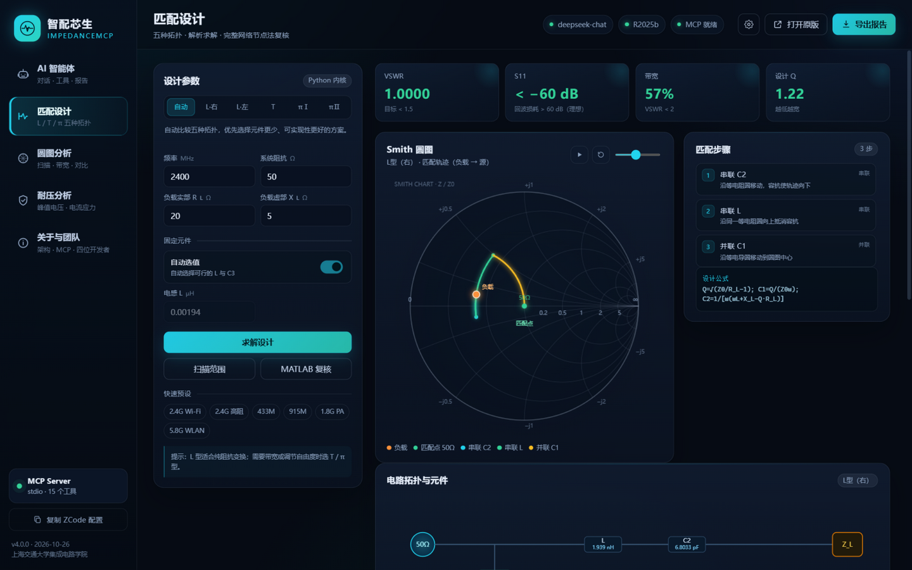
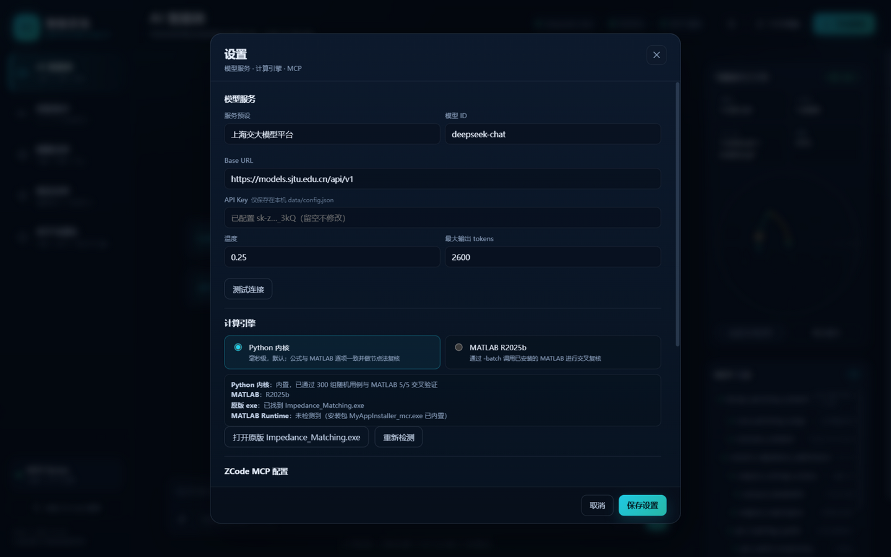
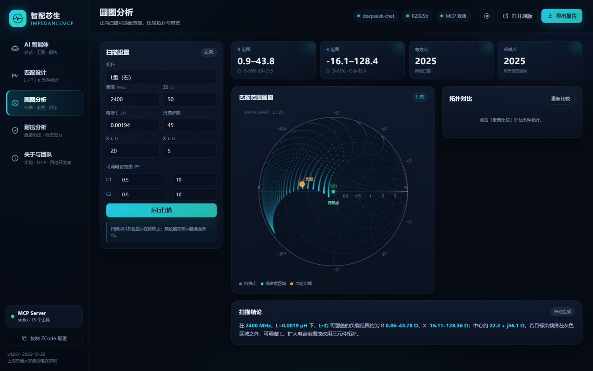
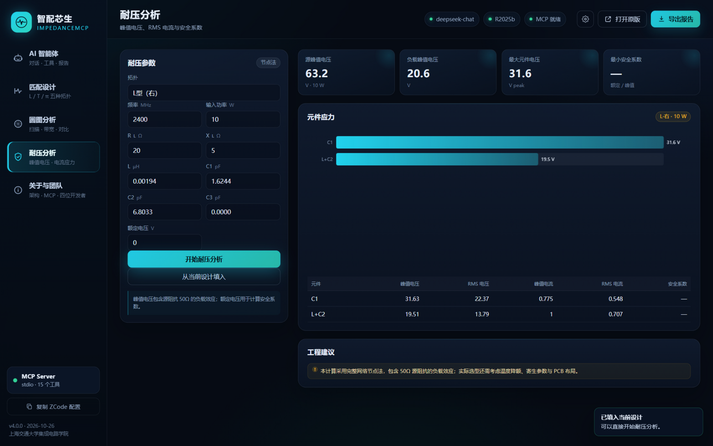

# 智配芯生 · ImpedanceMCP 用户手册

**版本：v4.0.0 ｜ 更新日期：2026-10-26**

开发者：卢瑞林、卢柯吉、林芷伊、张昀蕾
上海交通大学集成电路学院（信息与电子工程学院）
“智绘芯生，AI 赋能” AI 教与学活动周 · 赛道一（AI 智能体）

---

## 1. 软件简介

智配芯生 · ImpedanceMCP 是一套面向微波工程学习与设计的阻抗匹配软件。它由三部分组成：

1. **经典 MATLAB 内核**：原版 `Impedance_Matching.exe`（V3.0，App Designer + RF Toolbox），保留原有 L/T/π 五种拓扑、Smith 圆图动画与耐压分析。
2. **Python 智能外壳**：现代化 Web 界面、独立计算内核、DeepSeek 对话、附件解析、报告导出。
3. **MCP 服务器**：把匹配计算、扫描、复核、耐压、报告等能力封装成 15 个标准工具，可被 ZCode、Claude、Cursor 等任意 MCP 客户端调用。

> 一句话：**它既是一个更好用的匹配设计软件，也是一个能被 AI 智能体调用的微波仿真 MCP。**



---

## 2. 安装与启动

### 2.1 新版智能外壳

#### 运行环境

- Windows 10/11（64 位）
- Python **3.10 或更高**（推荐 3.11–3.14）
- 依赖：`numpy`
- 可选：`pypdf`、`openpyxl`、`Pillow`（用于 PDF/XLSX/图片附件）

#### 安装

```bat
cd "项目根目录"
pip install numpy pypdf openpyxl Pillow
```

如果只做匹配计算，`numpy` 足够；附件解析失败不会影响计算功能。

#### 启动

```bat
start_app.bat
```

或：

```bat
python app\run_app.py
```

启动后默认打开 `http://127.0.0.1:8765/`。端口被占用时会自动尝试后续端口（8766–8776）。

#### 停止

关闭命令行窗口，或在窗口中按 `Ctrl+C`。

### 2.2 原版 MATLAB 软件

原版 `Impedance_Matching.exe` 由 MATLAB R2023b 编译，运行需要：

1. **Visual C++ 运行库**：`Problem_Solution/VC_redist.x64.exe`
2. **MATLAB Runtime R2023b Update 10**

两种安装方式：

| 方式 | 文件 | 是否需要单独装 Runtime |
|---|---|---|
| 安装包（推荐） | `Main_Installation/MyAppInstaller_mcr.exe` | **不需要**，安装包已内置 Runtime |
| 便携 exe | `for_redistribution_files_only/Impedance_Matching.exe` | **需要**，先装 Runtime 与 VC++ |

> `MyAppInstaller_mcr.exe` 的工程配置为 `package.mcr=true`，这是 MATLAB Compiler 的“包含 Runtime”安装包，约 974 MB。直接双击安装即可。
>
> 便携版 exe 只有约 2.5 MB，必须依赖已安装的 MATLAB Runtime R2023b；如果目标电脑没有 MATLAB，请使用安装包方式。

安装完成后，可以在软件右上角点击「打开原版」启动经典界面。

### 2.3 配置 DeepSeek

打开右上角「设置」：

| 项目 | 交大平台 | DeepSeek 官方 |
|---|---|---|
| 服务预设 | 上海交大模型平台 | DeepSeek 官方 |
| Base URL | `https://models.sjtu.edu.cn/api/v1` | `https://api.deepseek.com/v1` |
| 模型 | `deepseek-chat` | `deepseek-chat` |
| API Key | 学校平台 Key | `sk-...` |

- API Key 只保存在本机 `data/config.json`，不会写入 Git 仓库。
- 点击「测试连接」会发送一条最小请求，显示延迟与模型名。
- 也可以用环境变量：`DEEPSEEK_BASE_URL`、`DEEPSEEK_API_KEY`，或 `SJTU_LLM_BASE_URL`、`SJTU_LLM_API_KEY`。
- 推荐使用 `deepseek-chat`（支持工具调用）；`deepseek-reasoner` 也可用，但工具调用能力取决于服务端实现。

### 2.4 可选：MATLAB R2025b 复核

如果本机安装了 MATLAB R2025b，软件可以调用 `matlab -batch` 对设计做独立复算：

- 在「设置 → 计算引擎」选择 `MATLAB R2025b`，或直接在设计页点击「MATLAB 复核」。
- 单次复核约 15–20 秒（MATLAB 启动时间占大部分）。
- 没有 MATLAB 不影响默认的 Python 计算。

---

## 3. 界面总览


### 3.1 左侧导航

| 页面 | 用途 |
|---|---|
| AI 智能体 | 自然语言对话、工具调用、设计卡片、附件 |
| 匹配设计 | 五种拓扑的参数输入、求解、圆图、带宽、灵敏度 |
| 圆图分析 | 正向扫描可匹配范围、拓扑对比 |
| 耐压分析 | 元件峰值电压/电流、安全系数 |
| 关于与团队 | 架构、MCP 配置、团队信息 |

### 3.2 顶部状态栏

- **模型状态**：显示当前模型名；未配置时显示“模型未配置”。
- **MATLAB 状态**：显示检测到的 MATLAB 版本（如 R2025b）。
- **MCP 就绪**：表示本地 MCP 服务可用。
- **设置**：模型服务、计算引擎、MCP 配置。
- **打开原版**：启动 `Impedance_Matching.exe`。
- **导出报告**：生成当前设计的 HTML 报告。

### 3.3 设置面板



设置分为三部分：

1. **模型服务**：预设、Base URL、API Key、模型、温度、最大输出 tokens、测试连接。
2. **计算引擎**：Python 内核 / MATLAB R2025b；显示 MATLAB、原版 exe、Runtime 状态。
3. **ZCode MCP 配置**：一键复制 JSON 配置。

---

## 4. AI 智能体

### 4.1 基本用法

在底部输入框描述需求，例如：

- “在 2.4 GHz 把 20+j5 Ω 匹配到 50 Ω，给出元件值和 VSWR。”
- “比较 L 型、T 型和 π 型，哪种更适合 100−j30 Ω 的高阻负载？”
- “为 433 MHz、15 Ω 的负载设计匹配网络，并分析 ±5% 容差和 10 W 耐压。”
- “解释史密斯圆图上串联电感和并联电容的轨迹方向。”

按 Enter 发送，Shift+Enter 换行。输入框右侧可选择模型。

### 4.2 智能体如何工作

1. 理解你的问题；
2. 调用本地 MCP 工具（设计、扫描、复核、耐压、知识库等）；
3. 读取工具返回的数值；
4. 用微波工程语言解释结论、公式和注意事项。

工具调用过程会以卡片形式显示在回答中：

- 工具名与中文标签
- 运行状态与耗时
- 结果摘要
- 可展开的原始 JSON

### 4.3 设计卡片

当工具返回一次完整设计时，对话中会出现一张设计卡：

- 电感 L、C1、C2、C3
- VSWR、S11、带宽、Q
- 「在设计中打开」「导出报告」按钮

点击「在设计中打开」会把参数填入匹配设计页，并加载完整圆图轨迹。

### 4.4 附件

点击输入框左侧的回形针上传附件。支持：

| 类型 | 扩展名 |
|---|---|
| 文本/代码 | `.txt .md .csv .json .xml .yaml .py .m .c .h .cpp .js .html .tex .log` |
| 文档 | `.pdf .docx` |
| 表格/演示 | `.xlsx .xlsm .pptx` |
| Notebook | `.ipynb` |
| 图片 | `.png .jpg .jpeg .bmp .gif .webp` |

- 单文件最大 25 MB。
- PDF 最多读取 80 页，单个附件最多 60,000 字符（超出会截断）。
- DeepSeek 文本模型不读取图片内容；图片会保存并提示用文字描述。
- 附件内容只作为资料，智能体不会执行附件中的“指令”。

### 4.5 右侧上下文

“当前设计上下文”显示最近一次设计：

- 元件值、VSWR、带宽
- 圆图缩略图
- 「在设计中打开」「导出报告」

“MCP 工具”列出 15 个工具及其用途；底部可复制 ZCode 配置。

### 4.6 使用建议

- 问题里尽量包含频率、负载 R/X、功率、带宽要求。
- 不确定拓扑时直接说“自动选型”。
- 需要工程建议时，明确问“容差/耐压/带宽/可实现性”。
- 如果智能体给出无解，让它“比较其他拓扑”。

---

## 5. 匹配设计

### 5.1 输入参数

| 参数 | 说明 |
|---|---|
| 频率 | 工作频率，MHz |
| 系统阻抗 Z0 | 默认 50 Ω |
| 负载实部 R_L | Ω，必须 > 0 |
| 负载虚部 X_L | Ω，可为负（容性） |
| 拓扑 | 自动 / L·右 / L·左 / T / πⅠ / πⅡ |
| 自动选值 | 开启时自动选择 L 与 C3 |
| 电感 L | µH；关闭自动选值后手动输入 |
| 电容 C3 | pF；T/π 型可手动输入 |

### 5.2 拓扑选择

| 拓扑 | 适用条件 | 特点 |
|---|---|---|
| L 型（右） | R_L < 50 Ω | 元件最少，效率高 |
| L 型（左） | R_L > 50 Ω | 高阻负载 |
| T 型 | 需要中间节点调节 | 三元件，可调带宽 |
| π 型Ⅰ | C-L-C 结构 | 两个并联电容，自由度更高 |
| π 型Ⅱ | 低阻负载 | 源端/负载端均可调 |
| 自动 | 不确定时 | 比较五种拓扑，优先 L 型 |

> 固定电容拓扑存在物理不可行区：强容性负载可能让 C1/C2 出现负值。此时软件会返回明确的无解原因，并建议替代拓扑。

### 5.3 求解

点击「求解设计」。软件会：

1. 读取参数并做单位换算；
2. 按拓扑公式求 C1、C2（必要时自动选 L/C3）；
3. 用完整网络节点法复核 `Zin`、`VSWR`、`S11`；
4. 计算带宽、灵敏度、工程风险；
5. 在 Smith 圆图上生成三段/四段轨迹。

### 5.4 结果卡片

顶部四个 KPI：

- **VSWR**：目标 < 1.5；1.0000 表示完全匹配。
- **S11**：低于 −60 dB 时显示“< −60 dB（理想）”。
- **带宽**：VSWR < 2 的分数带宽。
- **设计 Q**：越低越宽。

### 5.5 Smith 圆图

- 点击播放按钮开始动画；暂停/重置/速度滑块在右上角。
- 轨迹颜色对应步骤：串联 C2、串联 L、并联 C1 等。
- 鼠标悬停可查看该点的 Z、Γ、VSWR。
- 点击右侧步骤卡片可跳到该段轨迹终点。

### 5.6 带宽与灵敏度

- **VSWR 带宽**：固定元件值，在 ±60% 频率范围内扫频；阴影为 VSWR<2 频段。
- **±5% 灵敏度**：分别把每个元件偏离 ±5%，计算最差 VSWR；绿色 <1.5，黄色 <2，红色 ≥2。

### 5.7 工程提示

软件会自动提示：

- C1/C2 < 0.1 pF：寄生参数可能主导。
- L < 1 nH：PCB 走线电感不可忽略。
- Q > 20：带宽窄、对容差敏感。
- 元件值超出常规范围。

### 5.8 可选拓扑对比

自动模式下会列出其他可行拓扑的元件值、带宽、Q，点击「应用此方案」即可切换。

### 5.9 MATLAB 复核

点击「MATLAB 复核」会：

- 用当前拓扑与 L/C3 调用 MATLAB R2025b；
- 在 MATLAB 中重新解析求解并用节点法复核；
- 返回 `Zin`、`VSWR`、耗时。

要求本机安装 MATLAB R2025b；否则会提示不可用。

---

## 6. 圆图分析



### 6.1 正向扫描

1. 选择拓扑；
2. 输入频率、Z0、固定电感 L；
3. 设置 C1/C2/C3 的可调范围；
4. 点击「运行扫描」。

结果：

- 可匹配负载的 **R 范围**、**X 范围**；
- 有效扫描点数；
- 圆图上的扫描点云；
- 自动生成的扫描结论；
- 五种拓扑的可行性与带宽对比。

### 6.2 如何理解

- 点云覆盖的区域就是该拓扑 + 固定 L + 电容范围能匹配的负载集合。
- 目标负载落在区域外时，可以：
  - 调整 L；
  - 扩大电容范围；
  - 换三元件拓扑；
  - 检查负载是否强容性/强感性。

### 6.3 拓扑对比

点击「重新比较」会调用 `compare_topologies`，列出五种拓扑的元件值、带宽、Q 与推荐排序。点击「应用」可直接回到设计页。

---

## 7. 耐压分析



### 7.1 输入

- 拓扑、频率、负载 R/X；
- L、C1、C2、C3；
- 输入功率（W）；
- 元件额定电压（可选，用于安全系数）。

点击「从当前设计填入」可自动读取最近一次设计。

### 7.2 输出

- 输入峰值电压、源开路电压；
- 负载峰值电压；
- 各元件峰值电压、RMS 电压、峰值电流、RMS 电流；
- 安全系数 = 额定电压 / 峰值电压；
- 柱状图与工程建议。

### 7.3 注意

- 计算使用完整网络节点法，包含 50Ω 源阻抗的负载效应。
- 峰值电压不是简单的“源电压”，高 Q 节点可能远高于输入电压。
- 选型时建议额定值 ≥2× 峰值，并考虑温度降额与寄生。

---

## 8. 报告导出

点击右上角「导出报告」：

1. 生成 HTML 报告；
2. 在新标签页打开；
3. 用浏览器 `Ctrl+P` 选择“另存为 PDF”。

报告内容：

- 设计任务与拓扑图；
- 元件表；
- 节点法复核（Zin、VSWR、S11、回波损耗、Q、带宽）；
- Smith 圆图；
- VSWR 曲线；
- 匹配步骤；
- ±5% 灵敏度；
- 风险提示；
- 团队与版本信息。

报告文件保存在 `data/reports/`，文件名格式 `impedance_report_YYYYMMDD_HHMMSS_<topology>.html`。

---

## 9. MCP 接入

### 9.1 ZCode

配置位置：`~/.zcode/cli/config.json` 的 `mcp.servers`。

```json
{
  "mcp": {
    "servers": {
      "impedance-matching": {
        "type": "stdio",
        "command": "C:\\Python314\\python.exe",
        "args": ["D:\\path\\to\\app\\run_mcp.py"],
        "env": {"PYTHONUNBUFFERED": "1", "PYTHONIOENCODING": "utf-8"},
        "timeoutMs": 120000
      }
    }
  }
}
```

重启 ZCode 后即可在智能体中使用 `mcp__impedance-matching__design_matching_network` 等工具。

### 9.2 Claude Desktop / 其他客户端

参考 `mcp.example.json`，把 `args` 改成你本机的绝对路径。

### 9.3 工具调用示例

```text
请用 design_matching_network 设计 2.4 GHz、20+j5 Ω 的匹配网络，
然后用 compute_voltage_stress 分析 10 W 下的元件应力。
```

### 9.4 HTTP 模式

```bat
python app\run_mcp.py --http 8790
```

- `POST http://127.0.0.1:8790/mcp`
- `GET http://127.0.0.1:8790/health`

仅监听本机回环地址，不对外网开放。

---

## 10. 常见问题

### Q1：`MyAppInstaller_mcr.exe` 包含 Runtime 吗？

包含。工程配置 `package.mcr=true`，安装包内置 MATLAB Runtime R2023b，直接安装即可。
便携版 exe 才需要单独安装 `MATLAB_Runtime_R2023b_Update_10_win64.zip`。

### Q2：为什么还需要 VC_redist？

MATLAB 编译生成的 exe 依赖 Visual C++ 运行库。若目标电脑缺少，会提示缺少 DLL。
安装 `Problem_Solution/VC_redist.x64.exe` 即可。

### Q3：没有 MATLAB 能用吗？

能。默认 Python 内核完成所有计算、绘图、MCP 工具与 AI 对话。
MATLAB 只用于“MATLAB 复核”和“打开原版 exe”。

### Q4：DeepSeek 401 / 404 / 超时？

- 401：Key 无效或过期。
- 404：Base URL 或模型 ID 不对。
- 超时：网络/代理问题，或问题过长。
- 交大平台：`https://models.sjtu.edu.cn/api/v1` + `deepseek-chat`。
- 官方：`https://api.deepseek.com/v1` + `deepseek-chat`。

### Q5：设计无解 / C2 为负？

固定电容拓扑的物理限制。尝试：

- 换 `自动` 或其他拓扑；
- 调整 L/C3；
- 检查负载是否强容性/强感性；
- 降低频率或改用电感型网络。

### Q6：C2 只有 0.00x pF？

手动 L 太大。打开“自动选值”，或把 L 减小到 1–10 nH。

### Q7：端口被占用？

程序会自动尝试 8766–8776。也可以手动指定：

```bat
python app\run_app.py --port 8899
```

### Q8：ZCode 看不到工具？

1. 检查配置 JSON 语法；
2. 确认 `args` 路径存在；
3. 先运行 `python app\run_mcp.py`，看是否有报错；
4. 重启 ZCode。

### Q9：浏览器打不开 / 白屏？

- 确认命令行窗口没有报错；
- 尝试 `http://127.0.0.1:8765/`；
- 清除浏览器缓存或换 Edge/Chrome；
- 查看终端日志。

### Q10：报告中文乱码？

报告使用 UTF-8；浏览器应自动识别。若用旧版编辑器打开，请选择 UTF-8。

---

## 11. 版本与团队

**版本**：v4.0.0
**更新日期**：2026-10-26
**仓库**：<https://github.com/RuilinLu/Impedance_Matching_Calculation>

| 成员 | 分工 |
|---|---|
| 卢瑞林 | 项目负责人 · 算法与 MCP 架构 |
| 卢柯吉 | MATLAB 计算内核与仿真验证 |
| 林芷伊 | 交互设计、可视化与文档 |
| 张昀蕾 | 测试、演示与用户研究 |

上海交通大学集成电路学院（信息与电子工程学院）
“智绘芯生，AI 赋能” AI 教与学活动周 · 赛道一

> 本软件用于教学、科研与工程估算；正式产品请用实际元件模型与实测数据复核。
